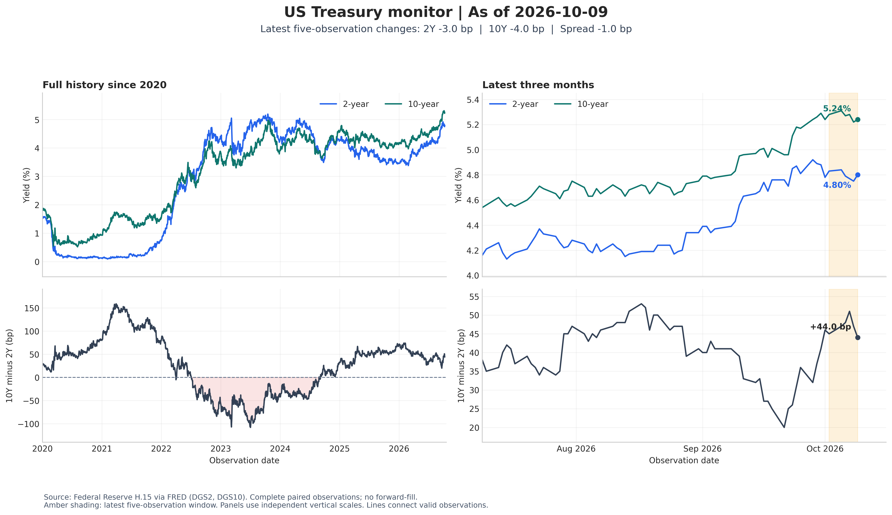

# Treasury Rates Monitor — FRED DGS2 / DGS10

> A Python monitor for U.S. Treasury yields: downloads 2-year (DGS2) and 10-year (DGS10) rates from FRED, runs explicit data-quality checks, and produces a client-ready weekly briefing with charts — the kind of rates snapshot a market-strategy desk starts its day with.



## What it does

- Pulls DGS2 + DGS10 from FRED (2020–present snapshot included in `data/`)
- Quality control first: missing-date review, long-gap review, absent-weekday checks, annual quality summary — gaps are reported, never silently filled
- Analysis: full-history and recent-window charts, weekly path summaries, 1 / 5 / 21-observation change horizons, 10Y–2Y slope context
- Outputs: analysis CSV, client monitor CSV, methodology note, quality-check files, run provenance (JSON), and a short weekly briefing text

## Run it

```bash
pip install -r requirements.txt
python task1.py
```

Outputs land in `rates_monitor/outputs/`. The full write-up of a completed run is in `reports/Task1_Treasury_Rates_Report.pdf`.

## Structure

```
task1.py            the monitor (download → QC → analysis → briefing)
data/               FRED Treasury snapshot (public data)
rates_monitor/      working data + generated outputs and charts
reports/            completed-run report (PDF)
```

## Data source

FRED, Federal Reserve Bank of St. Louis — series DGS2 and DGS10 (public).

## Author

**Umer Farooq** — Economic & Climate Risk Analyst · [LinkedIn](https://www.linkedin.com/in/umer-farooq-gojra/) · [GitHub](https://github.com/umerfarooq7424)

## License

MIT — see LICENSE.
